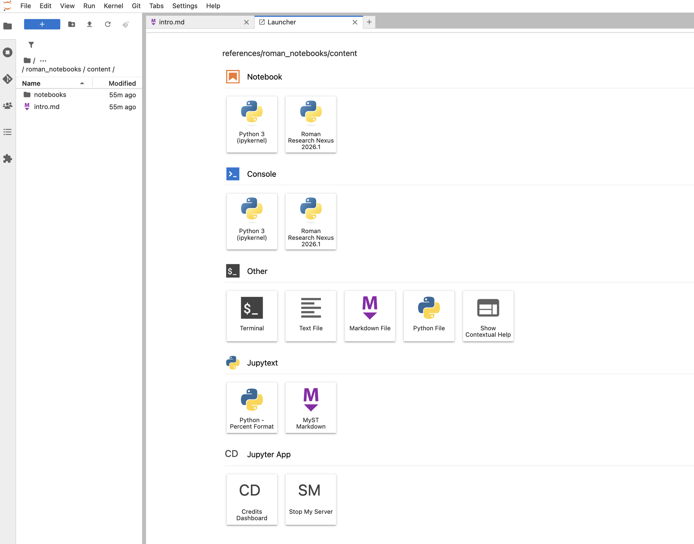

# Managing Your Server
When you access the Nexus without a running server, you are directed to the server configuration page, where you can select your account, platform image, and server type.
You can also access your server through **File → Hub Control Panel → My Server**.

For more information about available server configurations and persistent storage, see [Compute Resources](https://roman-docs.stsci.edu/data-handbook/roman-research-nexus/compute-resources) and [Storage Resources](https://roman-docs.stsci.edu/data-handbook/roman-research-nexus/storage-resources) in RDox.
## Starting Your Server
Your server starts automatically when you open JupyterLab if no server is running.

You can also start it manually from:
**File → Hub Control Panel → My Server**

If the server is stopped, **My Server** will start it and take you to JupyterLab.

## Stopping Your Server
Stopping ends your session and releases compute resources. Your files are not affected.

To stop your server:
**File → Hub Control Panel → Stop My Server**

You can also stop it from the JupyterLab Launcher by selecting **SM (Stop My Server)**:

Stopping is recommended when you are done working or when you need to relaunch your session with a different image or server type.

## Automatic Shutdown After Idle Time
To conserve shared resources and reduce unnecessary credit consumption, Nexus automatically stops servers that are not actively being used.
- **30 minutes:** Servers are stopped after 30 minutes if no notebook kernels or terminals are running.
- **4 hours:** Idle notebook kernels and terminals are automatically shut down after 4 hours of inactivity. Once they are closed, the 30-minute server shutdown timer begins.
A notebook left open but unused will therefore typically cause the server to stop after approximately **4.5 hours**. Actively executing notebook cells are not considered idle.

**Important:** Background jobs running in terminals may appear idle and be terminated. For long-running jobs, use notebook cells or configure periodic output.
Files saved in persistent storage remain available after shutdown, but unsaved work and data held only in memory are lost.
For additional details, see [Managing Idle Servers in RDox](https://roman-docs.stsci.edu/data-handbook/roman-research-nexus/compute-resources).
## Changing Your Server Configuration
You can change your server configuration only during startup.

To change it:
1. **Stop My Server**
2. Go to **Start My Server**
3. The server options page appears (image, server size)
4. Select your configuration and click **Launch**

Changes take effect immediately for the new session. For additional details on platform images and server availability, see the [related article in RDox](https://roman-docs.stsci.edu/data-handbook-home/roman-research-nexus).
## Named Servers
In addition to your default server, you can create additional independent servers.

To create one:
1. Go to **File → Hub Control Panel**
2. Under **Named Servers**, enter a name
3. Click **Add New Server**
Each named server runs independently and can be started or stopped separately. **All servers associated with the same account share the same persistent home directory**, so your files remain accessible across sessions and server configurations.
Named servers are useful when you need multiple concurrent sessions or different server configurations.

Use named servers when you need separate workspaces—for example, testing a clean environment without affecting your primary one.

For information on Real Time Collaboration Servers, please see the [Working on a Team Page](./teams.md).

---
*Last updated: November 2026*
