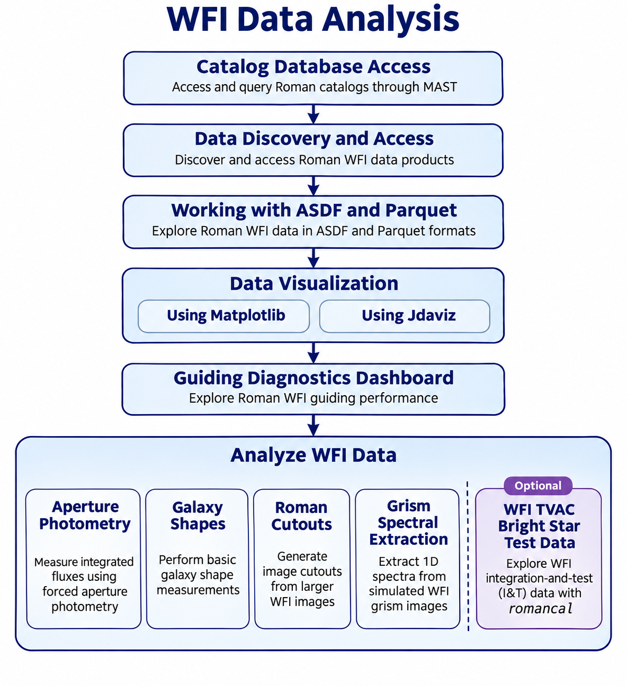

# RRN Science Workflows: WFI Data Analysis

This science workflow guides users through the discovery and access of data while working in the cloud, as well as the visualization and analysis of Roman WFI data products. While the current workflow focuses primarily WFI imaging data, it also includes an introductory spectroscopic example, a ground-test analysis use case, and an exploration of Roman WFI guiding performance.
 
## Workflow Overview

1. [**Catalog Database Access**](../../notebooks/catalog_database_access/catalog_database_access.ipynb)

   Access and query Roman catalogs through MAST using `astroquery` and advanced query techniques based on the Astronomical Data Query Language (ADQL) and the Table Access Protocol (TAP). Learn how to efficiently filter catalog data and select samples based on spatial location and other source properties.

2. [**Data Discovery and Access**](../../notebooks/data_discovery_and_access/data_discovery_and_access.ipynb)
   Discover and access Roman WFI data products through [MAST](https://archive.stsci.edu/), as well as simulated Roman WFI datasets available in the Nexus environment. Users can also access data from other missions hosted by MAST, including Hubble, TESS, and JWST. Data can be streamed directly into memory without the need for local downloads. To learn more, visit the [RDox pages on accessing Roman WFI data](https://roman-docs.stsci.edu/data-handbook-home/accessing-wfi-data).
  

3. [**Working with ASDF and Parquet Files**](../../notebooks/working_with_asdf/working_with_asdf.ipynb)

   Explore Roman WFI data products stored in the [Advanced Scientific Data Format (ASDF)](https://roman-docs.stsci.edu/data-handbook/wfi-data-levels-and-products/asdf-format-information) and Parquet formats. This step covers inspecting metadata, understanding data structures, and accessing image arrays and catalog data. To learn more, visit the [RDox pages on Roman WFI data levels and products](https://roman-docs.stsci.edu/data-handbook-home/wfi-data-format/data-levels-and-products).

4. **Data Visualization**

   Visualize Roman WFI data products using Matplotlib or Imviz, Jdaviz's image-visualization tool. This step focuses on inspecting image quality and exploring basic features of the data. For additional background information, consult the [Imviz documentation on ReadTheDocs](https://jdaviz.readthedocs.io/en/latest/imviz/index.html).

    - [**Using Matplotlib**](../../notebooks/data_visualization/data_visualization.ipynb)
    - [**Using Jdaviz**](../../notebooks/data_visualization/jdaviz_data_visualization.ipynb)

5. [**Guiding Diagnostics Dashboard**](../../notebooks/guiding_diagnostics_dashboard/guiding_diagnostics_dashboard.ipynb)

   Explore Roman WFI guiding performance using an interactive dashboard, including pointing jitter, noise-equivalent angles (NEAs), and guide window images.

6. **Analyze WFI Data** - Perform example analysis tasks on WFI data, including:
    - [**Aperture Photometry**](../../notebooks/aperture_photometry/aperture_photometry.ipynb): Measure integrated fluxes using forced aperture photometry on WFI images.
    - [**Galaxy Shapes**](../../notebooks/measuring_galaxy_shapes/measuring_galaxy_shapes.ipynb): Perform basic galaxy shape measurements on WFI images.
    - [**Roman Cutouts**](../../notebooks/roman_cutouts/roman_cutouts.ipynb): Use the [Astrocut service](https://astrocut.readthedocs.io/en/latest/) to generate image cutouts from larger WFI images for focused analysis.
    - [**Grism Spectral Extraction**](../../notebooks/grism_spectral_extraction/grism_spectral_extraction.ipynb): Extract one-dimensional spectra from simulated Roman WFI slitless grism images.
    - **Optional -** [**WFI TVAC Bright Star Test Data**](../../notebooks/ground_test_analysis/wfi_tvac_brightstar.ipynb): Explore WFI integration-and-test (I&T) data by processing a subset of Level 1 bright-star observations from the thermal-vacuum (TVAC) campaign with `romancal` and examining saturation behavior and frame-level effects.

## Caveats and Limitations

While the current workflow primarily focuses on WFI imaging investigations, it includes an introductory spectroscopic example. Expanded spectroscopic content will be added in future releases.

---
*Last Updated: November 2026*
